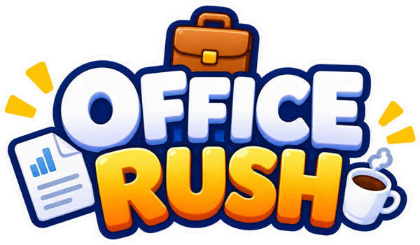
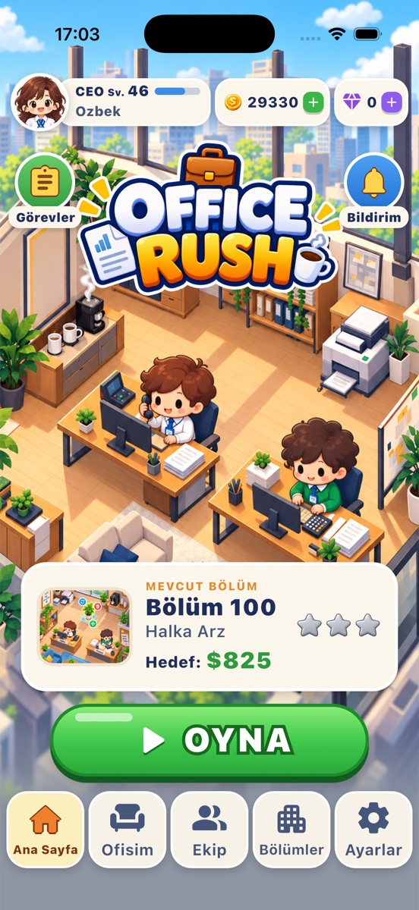
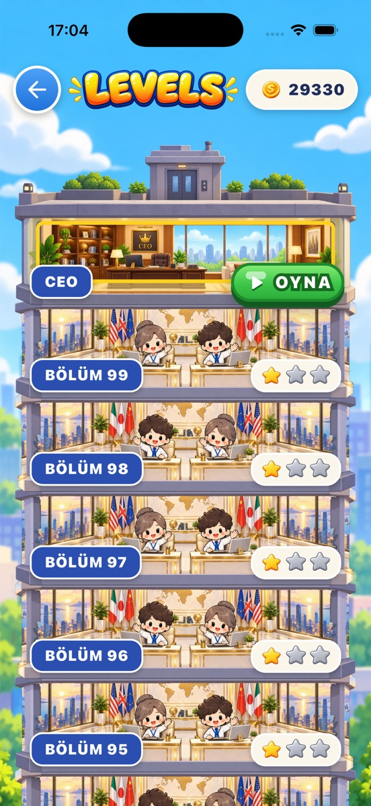
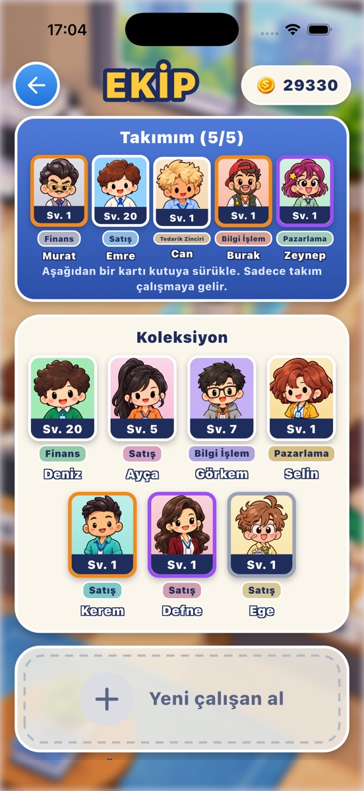
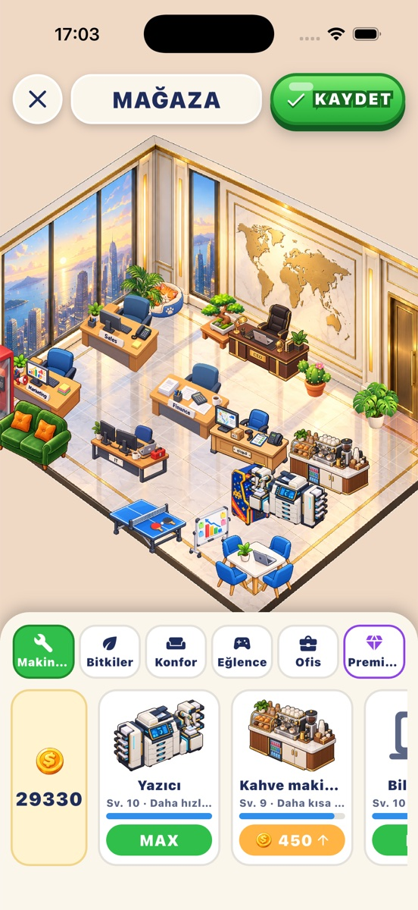
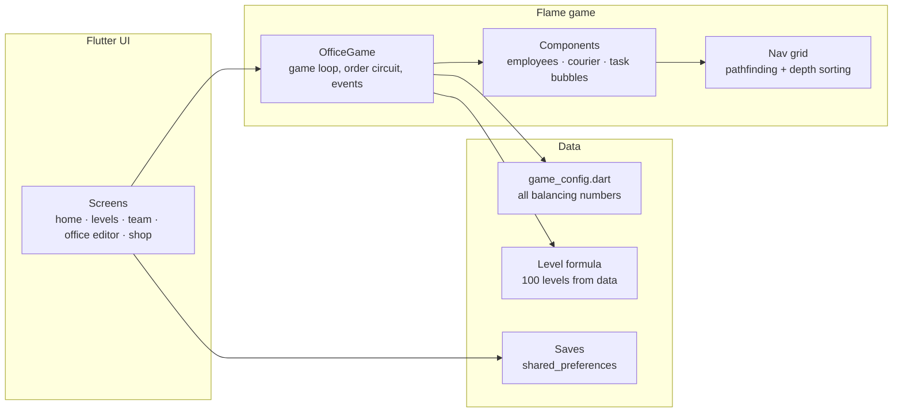

  

  <b>Run a small company, one busy workday at a time.</b> 
  A mobile <b>time-management game</b> set in an office, built with <b>Flutter</b> and the <b>Flame</b> game engine for iOS and Android.

  
  
  
  

> **🚧 Work in progress:** Office Rush is **still under development** and is **not released yet**. The game is playable from start to finish on the simulator, but the art, balancing and some features are still changing. The source code is private. This repository presents the project, and a detailed technical overview is available as a PDF: **[docs/officerush-overview.pdf](docs/officerush-overview.pdf)**.

---

## Screenshots

  
  
  
  

*(Screenshots of the current development build, in Turkish. The game is also available in English and French.)*

---

## The idea

Office Rush is a casual game in the spirit of classic time-management games, but set in an office. You are the CEO of a small company. During a workday of **2 to 3 minutes**, you give orders to your employees so they handle as many customer orders as possible before 6 PM. Between days, you hire people, train your team and decorate your office.

Short sessions, portrait mode, playable with one hand.

## Gameplay

| | Feature | Details |
|---|---|---|
| 📞 | **Order circuit** | The phone rings at Sales → the order is printed → Finance calculates it → a courier delivers it. The money only arrives when the courier leaves. |
| 👆 | **Contextual actions** | Tap an employee and big buttons appear for what they can do right now: answer, print, calculate, coffee break, report a breakdown… |
| ⚡ | **Energy and boosts** | Employees get tired and need coffee; a long press gives a short "Bravo!" speed boost with a cooldown |
| 🎲 | **Events** | Urgent calls, VIP customers, big orders, machine breakdowns, stock shortages, unlocked level by level |
| 🏢 | **100 levels in 5 chapters** | From a small office to an international headquarters, with a new mechanic every 3 to 5 levels and "boss days" (Black Friday, end of quarter, IPO) |
| 🧑‍💼 | **Team building** | Collection of employees with roles (Sales, Finance, IT, Supply Chain, Marketing), levels and upgrades; a 5-card team is chosen before each day |
| 🛋️ | **Office editor** | Buy furniture and machines in the shop and place them on an isometric grid; some items give small bonuses |
| 💎 | **Economy** | Coins and gems, daily missions, shop, in-app purchases |

---

## How it is built

- **Levels are data, not code.** A formula generates each level (money target, calls per minute, VIP rate, events, required roles) from its number, with a little randomness. Hand-made "boss days" are added on top.
- **All balancing in one file**: changing the difficulty never requires touching the game code.
- **Isometric scene** with depth sorting by Y and grid pathfinding, so characters walk around furniture.
- **Procedural animation**: the walking effect (bounce, sway, left/right mirroring) is done in code, so each character only needs a few images.
- **All UI is drawn in code**; images are only used for rooms, furniture, characters and icons.

## Tech stack

| Layer | Technologies |
|---|---|
| Game | Flutter, Flame (game loop, components, effects) |
| Language | Dart (about 19,000 lines) |
| Data | Levels generated by formula, saves with `shared_preferences` |
| Monetization | `in_app_purchase`, `google_mobile_ads` |
| Localization | English, French and Turkish |
| Tests | 17 test files: game logic, pathfinding, order circuit, level formula, office layout |
| Art | 2D isometric assets made for the game and integrated in Flutter |

---

## Status and roadmap

| Date | Milestone |
|---|---|
| September 2026 | Game design document, first prototype with simple shapes |
| October 2026 | Order circuit, energy, events, 100-level roadmap, real art |
| November 2026 | Team cards, office editor and shop, daily missions, in-app purchases |
| **In progress** | Balancing, polish, sounds, more animations |
| Next | Beta on TestFlight and Google Play, then public release |

## What I am learning

- **Game architecture** with an entity-component engine (Flame) inside a Flutter app
- **Data-driven design**: one formula and one config file for 100 levels
- **Pathfinding and isometric rendering** on a mobile screen
- **Game feel**: timers, feedback, difficulty curve, one-hand controls
- **Testing game logic** with unit and widget tests
- **Monetization and store rules** for a free-to-play mobile game

---

  Designed and developed by <b>Görkem Özbek</b> · 🚧 in development

